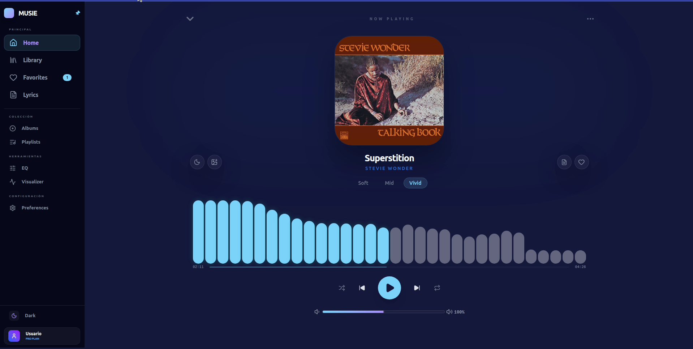
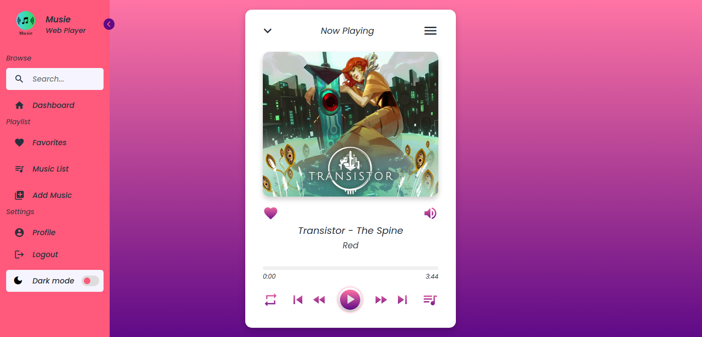

<div align="center">
  
  <br />
  <br />

# 🎵 Musie

### Tu música local, bajo tu control

Reproductor de audio **local-first**, privado y ligero para recuperar,
organizar y disfrutar tu colección musical sin depender de la nube.

  <br />

[](https://nicovel98.github.io/musie/)
[](#-por-qué-musie)

</div>

<br />

> **La música permanece en tu dispositivo.** Musie combina una interfaz moderna
> con controles de reproducción precisos, playlists persistentes y una
> experiencia pensada también para móvil.

## ✨ Descubre Musie

<div align="center">

**[▶ Explorar la demo web](https://nicovel98.github.io/musie/)**

Importa tus canciones, crea tu biblioteca y prueba el reproductor directamente
desde el navegador, sin crear una cuenta.

[](https://nicovel98.github.io/musie/)

</div>

## 💜 Por qué Musie

| Privacidad                                                        | Control                                                              | Experiencia                                                      |
| ----------------------------------------------------------------- | -------------------------------------------------------------------- | ---------------------------------------------------------------- |
| Tus archivos se procesan localmente y no salen de tu dispositivo. | Ecualizador paramétrico, visualizador y controles de audio precisos. | Interfaz clara, responsive y optimizada para escritorio y móvil. |

## 🎶 Playlists que se adaptan a ti

La **cola activa** y las playlists guardadas están separadas para que organizar
tu colección no interrumpa la canción actual.

- Crear, editar, duplicar, buscar y eliminar playlists.
- Reordenar canciones y usar **Reproducir después** o **Añadir a la cola**.
- Usar Shuffle sin repeticiones prematuras y Repeat por pista o playlist.
- Limpiar canciones próximas sin perder la pista actual.
- Restaurar canción, cola, contexto, modo Shuffle/Repeat y posición al volver a
  abrir la aplicación.
- Reintentar una pista cuando el navegador no puede cargar el audio.

En móvil, las acciones principales permanecen visibles y las acciones
secundarias se agrupan en menús contextuales para evitar desbordamientos.

## 🎨 Evolución visual

Musie evolucionó desde una primera idea hacia una experiencia más clara,
centrada en la reproducción y la biblioteca musical.

| Idea inicial                            | Musie mejorado                            |
| --------------------------------------- | ----------------------------------------- |
|  |  |

El diseño utiliza una estética moderna inspirada en **Glassmorphism**, con
jerarquía visual, controles accesibles y una navegación más cómoda.

- **[Ver diseño en Figma](https://www.figma.com/file/C4ZuwHwHuSWdgDzrsM8DDT/Reproductor-de-m%C3%BAsica%3A-Musie?node-id=0%3A1&t=qdhn0wQ1TfIcGm7J-1)**

## 🧩 Funcionalidades principales

- Biblioteca de canciones, álbumes, favoritos y playlists.
- Reproducción con Howler.js y procesamiento mediante Web Audio API.
- Persistencia local con IndexedDB.
- Cola inteligente con Shuffle, Repeat y navegación estable.
- Recuperación de reproducción y posición exacta.
- Diseño responsive con controles optimizados para móvil.

## 🚀 Instalación local

```bash
cd frontend
npm install
npm run dev
```

Después, abre [http://localhost:5173](http://localhost:5173) en tu navegador.

La demo se publica automáticamente mediante **GitHub Actions + GitHub Pages**.

## 🛠️ Stack tecnológico

- React + Vite + TypeScript + Tailwind CSS
- Web Audio API para ecualizador y visualizador
- Howler.js para gestionar la reproducción
- IndexedDB para persistencia local
- Lucide React para iconos
- Framer Motion para animaciones

## 📚 Documentación

- **[Wireframe del reproductor](docs/WIREFRAME_REPRODUCTOR.md)**
- **[Pruebas de reproducción](docs/PLAYBACK_TESTS.md)**
